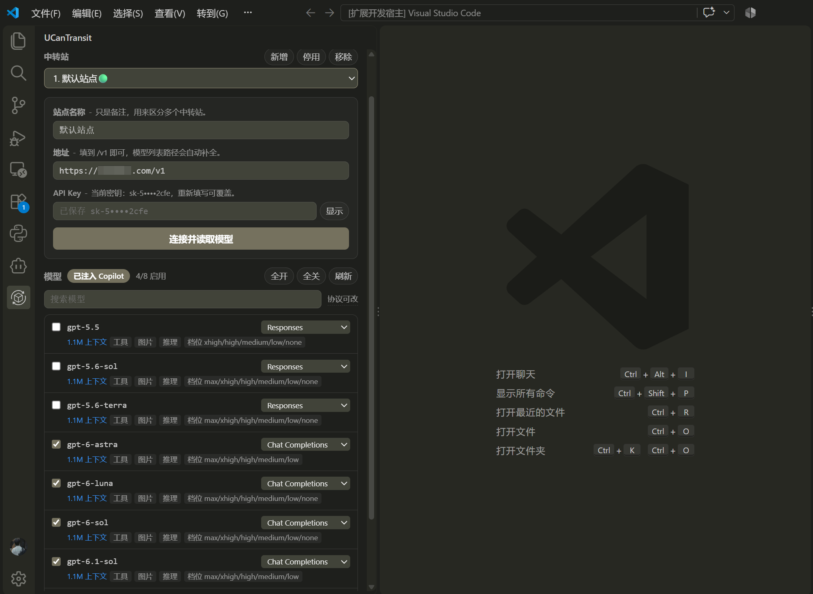
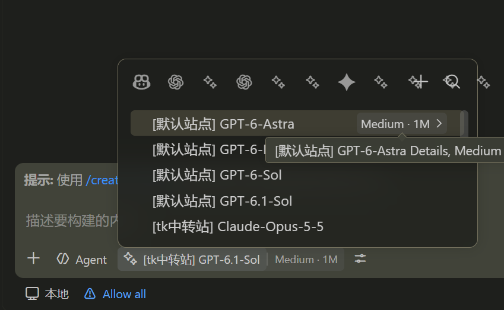

# UCanTransit for Copilot  

> **填入 URL 与 API Key，任意中转站或官方 API 端点立刻出现在 GitHub Copilot 的模型选择器里。**

零配置：不用选协议、不用挑能力、不用维护模型清单。第三方中转站、官方 API、自建网关都能接——OpenAI Responses、OpenAI Chat Completions、Anthropic Messages、Gemini 四种形态按模型自动匹配，一个地址加一把 Key 就能用。

## 不是替换 Copilot，而是增强它

Copilot 的聊天界面、Agent 模式、工具调用、指令与 Skills 全部留在原处，本扩展只给模型选择器多挂一个模型来源；需要配置时才打开侧边栏面板。

- **接入只要两样东西**：调用端点地址 URL 与 API Key。模型清单、上下文长度、工具 / 图片 / 推理能力、每个模型的原生协议全部自动获取，一个参数都不用手填。
- **多个站点可以同时用**：任意多家中转站并存，各自的地址、Key、模型与协议设置互不干扰；全模型与四套协议（OpenAI Chat Completions、OpenAI Responses、Anthropic Messages、Gemini）统一收进同一个模型选择器，同站模型排在一起，也能只停用其中一家而不影响其他。
- **能力栈原样继承**：Agent 模式的多步任务、文件 / 终端 / Git / 测试工具调用、`.instructions.md` 与 `AGENTS.md`、多轮工具编排，跑的都是 Copilot 自己那一套。
- **零侵入**：不修改 Copilot 的任何设置，不接管它的请求，也不新增聊天界面；没有学习成本。
- **零运行时依赖**：纯 VS Code API + Node 内置模块，不需要 Python、Docker 或本地代理进程。
- **密钥只进系统密钥库**：按站点分开存放在 `SecretStorage`，永不写入 `settings.json`，也不会进 Git 历史。
- **随时可回滚**：停用一个站点即撤销它的模型，清空站点只删该站点的数据，总开关一关 Copilot 立刻恢复原状。

**关于插件名字。** `UCanTransit` 读作 *U Can Transit*，取「你也能中转」的意思：请求在你和任意上游之间透明转接，模型照旧出现在 Copilot 原生的选择器里。`for Copilot` 则划清边界——它是给 Copilot 增配，不是另一个聊天客户端。

<p align="center">
  
</p>
<p align="center"><sub>侧边栏面板：填地址与 Key，勾选要注入的模型</sub></p>

<p align="center">
  
</p>
<p align="center"><sub>模型选择器：<code>[站点] 模型</code>，同站模型排在一起</sub></p>

## 为什么是它

| 能力 | 说明 |
|---|---|
| 两步接入 | 填调用端点地址 URL 与 API Key，点「连接并读取模型」，其余全自动 |
| 协议按模型自适应 | 同站点的 GPT / Claude / Gemini / DeepSeek 各走原生协议，猜错自动回退重试 |
| 多站点并行 | 每个站点独立地址与 Key，可单独启停；选择器里以 `[站点] 模型` 区分 |
| 能力自动识别 | 内置 models.dev 快照（5000+ 条），带后缀改写的 id 也能对回官方模型 |
| 思考强度可调 | 支持推理的模型在选择器里直接给出档位下拉 |
| 随时可回滚 | 关掉总开关，模型立即消失，不改动 Copilot 任何配置 |

GPT-6.1、Claude Opus 5.5、DeepSeek V4.1 Flash（1017）、GLM-5.3、Kimi K3、Gemini 3 Pro 这类新模型开箱即用：名字对得上就自动带上上下文长度、工具调用、图片输入与推理标记。

## 支持的协议

协议跟着**模型**走，不跟站点走：每扫到一个模型，按模型名推断它的原生协议，面板里还能逐个改。

| 协议 | 端点 | 默认给谁用 |
|---|---|---|
| OpenAI Responses | `/v1/responses` | `gpt-*`（3.x 除外）、`o1`/`o3`/`o4`、`codex` |
| Anthropic Messages | `/v1/messages` | `claude-*`、`anthropic/*` |
| Gemini | `/v1beta/models/{model}:streamGenerateContent` | `gemini-*`、`gemma-*` |
| OpenAI Chat Completions | `/v1/chat/completions` | 其余全部，以及任何猜错后的兜底 |

推断只是起点：请求失败且还没输出任何内容时，会自动退回 Chat Completions 重试一次，成功就把这个模型的协议改成 Chat，下次直接用。

## 工作原理

1. 面板填地址与 API Key，点「连接并读取模型」。
2. 用最通用的 `/models` 拉取名单（兼容 `/v1/models`、裸数组、Gemini 的 `models` 形态）。
3. 按模型名分配默认协议，并补全上下文长度、工具调用、图片输入、推理能力。
4. 从 OpenRouter 公共目录获取思考强度档位，在 Copilot 选择器里生成下拉。
5. 写入配置后立即通知 Copilot 刷新，无需重载窗口。
6. 总开关一关，模型立即撤销，Copilot 恢复原状。

能力信息按优先级取值：

| 优先级 | 来源 | 说明 |
|---|---|---|
| 1 | models.dev 内置快照 | 5000+ 模型，按 id 归一化 + 多数投票合并 |
| 2 | 模糊匹配 | 精确命中不到时，取「被模型 id 包含」的最长官方 id：`gpt-4o-优化版` → `gpt-4o`，`demo-pro-优化版` 优先命中 `demo-pro` 而不是更短的 `demo` |
| 3 | 名称关键词规则 | `vl` / `vision` / `llava` / `gpt-4o` 判为图片能力 |
| 4 | 保守默认 | 128K 上下文、支持工具、不启用图片与推理 |

**图片能力绝不瞎猜**：猜错会让用户一发图就失败，拿不准就按不支持处理。

## 安装与调试

### 前置要求

- VS Code 1.120 或更高
- 已安装 GitHub Copilot Chat 扩展（免费版即可）
- 一个可用的中转站或官方 API 端点，以及它的 API Key

### 方式一：调试运行（推荐先这样验证）

```bash
npm install
npm run compile
```

用 VS Code 打开本目录，按 `F5`，在新窗口点左侧活动栏的 UCanTransit 图标。

### 方式二：打包安装

```bash
npm run package
code --install-extension ucantransit-0.6.0.vsix
```

## 使用步骤

1. 点活动栏的 UCanTransit 图标。
2. 填地址（带不带 `/v1` 都行）和 Key，协议不用选，扫完自动按模型分好。
3. 点「连接并读取模型」，完成后顶部显示「已注入 Copilot」。
4. 打开 Copilot Chat 的模型选择器，选 `[站点名] 模型名`。
5. 需要调思考强度时，展开该模型右侧的档位按钮。

## 面板功能

- **多站点并行**：每个站点独立地址与 Key，同时生效；下拉里带序号与状态灯（🟢 启用 / ⚪ 停用），可单独停用某个站点而不删配置。
- **模型勾选**：每行一个开关，配合「全开 / 全关」，避免两百个模型全塞进选择器。
- **模型协议**：每行右侧一个下拉，随时把单个模型切到 Chat / Responses / Messages / Gemini，改完立即生效。
- **思考档位**：已抓到档位的模型不显示按钮；缺档位、或之前手动套用过时，可点开借用本站其他模型的档位，标记为「(手动)」，刷新不会被冲掉，也能恢复自动识别。
- **搜索**：按模型 id 过滤，模型多时用。
- **操作提示**：扫描完成、切换协议、启停模型、启停站点都会弹一条提示。
- **清空当前站点**：只清当前站点的模型和 Key，其他站点不受影响。

## 测试

```bash
# macOS / Linux
for f in 测试脚本/*.js; do node "$f"; done
```

```powershell
# Windows PowerShell
Get-ChildItem 测试脚本/*.js | ForEach-Object { node $_.FullName }
```

| 脚本 | 覆盖内容 |
|---|---|
| `扫描逻辑自检` | 快照解析、能力推断、模糊匹配（后缀改写、最长优先、不误命中）、列表格式兼容、`/v1` 缺失回退 |
| `协议自检` | 四种协议的文本 / 思考 / 工具调用、协议推断、`max_tokens` 被拒重试、思考强度与温度透传 |
| `思考档位自检` | 枚举内容、「停用」出现条件、按强度排序、英文标签、默认档回退 |
| `思考开关自检` | DeepSeek / GLM / Kimi / Qwen / Gemini 等模型的思考开关、400 重试、思考内容转发 |
| `多站点注入自检` | 多站点同时注入、id 前缀隔离、请求回到所属站点、站点启停、模型名带站点 |
| `配置读写自检` | 批量启停不丢数据、单模型改协议不影响其他、多站点隔离 |
| `刷新合并自检` | 刷新保留启停/协议/手动档位，能力与上下文用上游新值，下架模型移除 |
| `模型名自检` | 展示名大小写规则，只改大小写、字符不多不少 |

全部脚本只在 `127.0.0.1` 随机端口起临时服务，不联网、不写系统，也不依赖真实的 VS Code 环境。

## 手工验收清单

| 步骤 | 预期 |
|---|---|
| 填错误地址 | 面板显示错误，Copilot 原有模型不受影响 |
| 填正确地址和 Key | 显示「已注入 Copilot」与模型数量 |
| 模型选择器 | 每行形如 `[站点名] 模型名`，同站模型排在一起 |
| 对支持推理的模型 | 模型选择器里出现「思考强度」下拉 |
| 发普通对话 | 流式返回；模型有思考过程时显示折叠的思考块 |
| Agent 模式读文件 | 工具调用成功，可连续多轮 |
| 发图片给视觉模型 | 正常识别；不支持视觉的模型不给图片入口 |
| 关闭顶部开关 | 模型消失，Copilot 原生模型正常 |
| 「新增」再加一个站点 | 两个站点同时注入，模型名前缀为 `[站点名]` |
| 清空当前站点 | 其余站点不受影响 |

## 安全与可回滚

- Key 存 VS Code 的 `SecretStorage`，按站点分开，不写入设置文件或日志。
- 只新增自己的贡献项（provider + 侧边栏视图），**不修改 Copilot 的任何配置**。
- 关闭开关 = 立即不提供模型；清空站点 = 删自己这个站点的数据；卸载扩展 = 设置里剩下 `ucantransit.*` 若干空值，删掉即可。
- 面板里模型名按纯文本渲染，不会把上游返回的内容当 HTML 执行。

## 已知限制

- Token 计数是估算（汉字约 1.5 字符/token，其余约 4 字符/token），用于上下文预算提示，不影响请求本身。
- 思考档位只有 OpenRouter 公开提供；查不到的模型只显示「推理」标签，不给下拉。国内访问失败时用 24 小时缓存兜底。
- 思考内容的展示需要 VS Code 提供 `LanguageModelThinkingPart`；没有时自动降级为不显示，不影响对话。

## 目录结构

```
UCanTransit for Copilot
├─ src/                      扩展源码（TypeScript，编译到 out/）
│  ├─ extension.ts           注册 provider、面板、命令，监听配置变化
│  ├─ provider.ts            Copilot 的 LanguageModelChatProvider 实现
│  ├─ protocols/             四种协议的请求构造与流式解析
│  │  ├─ openai.ts           Chat Completions
│  │  ├─ responses.ts        OpenAI Responses
│  │  ├─ anthropic.ts        Anthropic Messages
│  │  ├─ gemini.ts           Gemini generateContent
│  │  ├─ thinking.ts         思考开关与档位注入
│  │  ├─ index.ts            分发与协议标签
│  │  └─ types.ts            共用类型、协议推断
│  ├─ report.ts              文本 / 思考 / 工具调用上报
│  ├─ http.ts                重试、超时、SSE 与 NDJSON 解析
│  ├─ modelCatalog.ts        模型列表拉取、格式兼容、能力合并
│  ├─ modelsDev.ts           models.dev 快照索引、投票合并与模糊匹配
│  ├─ reasoningCatalog.ts    OpenRouter 思考档位（24 小时缓存）
│  ├─ displayName.ts         模型展示名整理
│  ├─ config.ts              多站点、站点启停、模型与密钥读写
│  ├─ panel.ts               侧边栏 WebviewView
│  └─ types.ts               共用类型
├─ media/                    面板资源与图标
│  ├─ panel.html / panel.css / panel.js
│  ├─ models_dev.json        模型能力快照
│  ├─ icon.svg               活动栏与面板 logo（mask 渲染）
│  └─ icon.png               市场主图
├─ 测试脚本/                 不依赖 VS Code 的自检与预览
│  ├─ 多站点注入自检.js      多站点注入、id 隔离、请求路由、站点启停
│  ├─ 扫描逻辑自检.js        快照解析、能力推断、模糊匹配、列表格式兼容
│  ├─ 协议自检.js            四种协议的文本 / 思考 / 工具调用
│  ├─ 思考档位自检.js        档位枚举、排序、默认值回退
│  ├─ 思考开关自检.js        DeepSeek / GLM / Kimi / Qwen / Gemini 思考开关
│  ├─ 配置读写自检.js        批量启停、单模型改协议、多站点隔离
│  ├─ 刷新合并自检.js        刷新时保留用户设置、同步上游新值
│  ├─ 模型名自检.js          展示名大小写规则
│  ├─ 面板预览/              面板排版与配色的静态预览
│  └─ 图标预览/              活动栏图标在深浅主题下的效果预览
├─ package.json              扩展清单（贡献点、分类、关键词、图标）
├─ README.md                 本文档
├─ CHANGELOG.md              版本记录
├─ LICENSE                   MIT
└─ .vscodeignore / .gitignore
```

